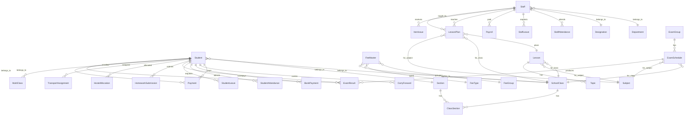
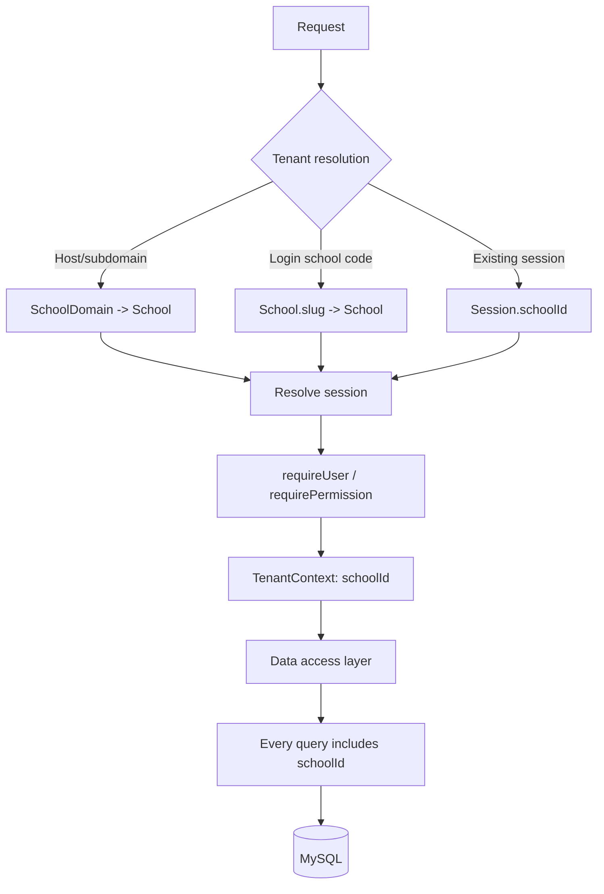
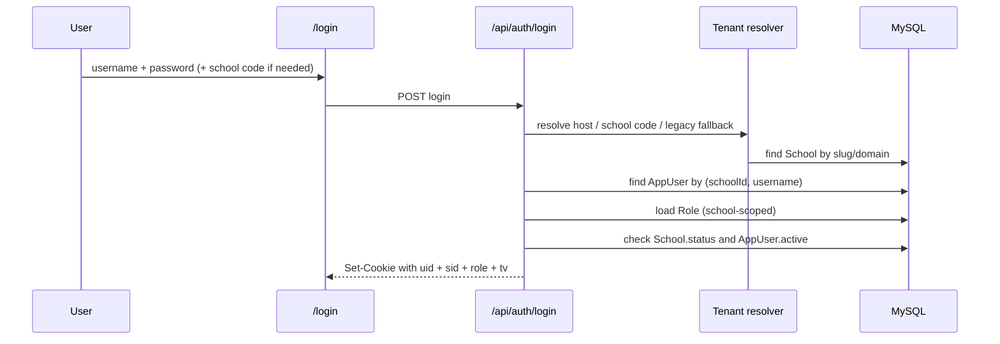

# School ERP → Multi-Tenant SaaS
## Phase 1: Architecture Analysis & Migration Plan

**Status:** Analysis only. No application code, database schema, or data has been changed.

**Repository:** `E:\School-Managment`  
**Analyzed:** 2026-11-06  
**Application:** ICE School Manager (`ice-school-manager` v1.0.0)

---

## 1. Executive Summary

The existing system is a **single-tenant school ERP** built with:

- **Next.js 15 App Router** (React 19, TypeScript)
- **Route Handlers** under `src/app/api`
- **Prisma ORM 6** against **MySQL 8**
- A **custom stateless HMAC cookie session** (no NextAuth/Auth.js)
- **83 generic CRUD resource definitions** and **40 API route handlers**
- **97 Prisma models/tables**
- A single catch-all UI route with **21 navigation groups** and **130 navigation entries**

The application has no concept of a school/tenant. Every query, counter, setting, role, user, and unique constraint is global. The recommended target is a **shared-database, shared-schema multi-tenant model**: add a `School` entity and a mandatory `schoolId` to every school-owned table, resolve the tenant at login/session time, and enforce tenant scoping in one central data-access layer.

This preserves the existing UI, modules, business logic, and API shapes while adding tenant isolation.

**Critical findings:**

1. `Setting`, `AdmitTemplate`, `MarkTemplate`, and `IdCardTemplate` are hard-coded singleton rows with `id = 1`.
2. `Counter` is a global key/value table, so admission numbers and receipt numbers are shared across all future schools.
3. `AppUser.username` and `Role.name` are globally unique, so two schools cannot both have an `admin` user or an `Admin` role.
4. Many natural keys are globally unique: admission number, employee ID, receipt number, category names, vehicle numbers, library card numbers, etc.
5. Authentication carries no school context. A signed cookie is valid for the entire database.
6. The generic resource engine and most service libraries query Prisma directly with no tenant filter. This is the main isolation risk.
7. `system/reset` truncates **all tables**, and `system/restore` deletes **all rows** in the backup model list. Both are unsafe in a shared multi-tenant database.
8. There is no `middleware.ts`; protection is a mix of layout redirects and per-route permission checks.
9. There are no automated tests, no CI pipeline, no deployment manifests, and no durable rate limiter.
10. Files are stored as `LONGTEXT` in MySQL; this will not scale well for a SaaS document/download workload.

**Decision requested:** approve the target architecture and the open decisions in Section 11 before implementation begins.

---

## 2. Current Architecture

### 2.1 Technology stack

| Layer | Technology | Notes |
|---|---|---|
| Framework | Next.js `15.5.28` | App Router, Route Handlers, server components |
| UI | React `19.1.10` | Client-heavy page renderer + server layout |
| Language | TypeScript `5.7` | Strict-ish project configuration |
| Database | MySQL 8.0 | Named database `ice20manager` |
| ORM | Prisma `6.19.3` | Single schema, generated client |
| Auth | Custom HMAC-SHA256 cookie | `ice_session`, 12-hour expiry |
| Password hashing | `bcryptjs` | Cost factor 10 |
| Validation | `zod` listed but unused | Manual coercion/validation in services |
| Styling | Global CSS | `src/app/globals.css` |
| File storage | MySQL `LONGTEXT` | Content/download center |
| Tests | None detected | No test runner or test files |
| CI/CD | None detected | No GitHub Actions/Docker/Vercel config |

### 2.2 Request flow (current)

```mermaid
flowchart LR
  B[Browser] --> N[Next.js App Router]
  N --> L[app/(app)/layout.tsx<br/>session check]
  N --> R[40 Route Handlers<br/>/api/**]
  R --> A[requireUser / requirePermission]
  A --> S[Service libraries<br/>fees, attendance, reports, resources]
  S --> P[Prisma Client]
  P --> M[(MySQL 8)]
  L --> P
```

- UI routes are served by `src/app/(app)/[[...slug]]/page.tsx` → `PageRenderer` → page component.
- The app layout checks the cookie and redirects to `/login` if absent.
- API route handlers perform their own auth check. There is **no global middleware** and no central tenant boundary.
- Generic CRUD goes through `/api/resources/[resource]` and `/api/resources/[resource]/[id]`.
- The resource engine is defined in `src/lib/resources.ts` (83 resources).
- Specialized actions go through `/api/actions/[action]` (11 actions).

### 2.3 Project structure

```text
prisma/
  schema.prisma                 97 models, MySQL
  seed.ts                       demo seeding entry point
  migrations/20261028144430_init
src/
  app/
    (app)/
      layout.tsx                session gate + AppShell
      [[...slug]]/page.tsx      single catch-all page
    api/                        40 route handlers
    login/page.tsx
    layout.tsx
    globals.css
  components/
    AppShell.tsx                navigation, search, assistant
    LoginForm.tsx
    LookupProvider.tsx
    crud/GenericCrud.tsx        generic list/create/edit/delete UI
    pages/                      14 page modules + configs.tsx
    nav.ts                      21 groups, 130 entries
  lib/
    auth.ts                     session, permissions, audit
    prisma.ts                   singleton Prisma client
    resources.ts                generic resource engine (83 resources)
    fees.ts, attendance.ts, exams.ts
    reports.ts, dashboard.ts, communications.ts
    settings.ts, backup.ts, seed.ts
    dmmf.ts                     Prisma metadata reflection
scripts/
  db-start.ps1, db-stop.ps1
```

### 2.4 Database and ORM

- **Database:** MySQL 8.0, InnoDB, `utf8mb4`.
- **ORM:** Prisma Client, one datasource, one schema.
- **Primary keys:** `String @id @default(cuid())` for almost all business tables.
- **Money:** `Decimal(12,2)` in MySQL; serialized to numbers only at API boundaries.
- **Dates:** MySQL `DATE` for business dates; serialized as `YYYY-MM-DD`.
- **JSON:** `Setting` has no JSON, but `Role.perms`, `Student.custom`, `Notice.audience` use `Json`.
- **Migrations:** one initial migration `20261028144430_init`.
- **Reflection:** `src/lib/dmmf.ts` reads Prisma DMMF metadata at runtime to drive generic input coercion, serialization, and backup restore.

### 2.5 Authentication (current)

| Item | Current behavior |
|---|---|
| Cookie name | `ice_session` |
| Token | `base64url(JSON payload).HMAC-SHA256` |
| Payload | `uid`, `username`, `name`, `role`, `exp` |
| Expiry | 12 hours |
| Signature secret | `AUTH_SECRET`; dev fallback if missing |
| Session storage | Stateless; no DB session table |
| Login lookup | `AppUser.username` (global) |
| Password | bcrypt hash, cost 10 |
| Permissions | `Role.perms`: `"all"` or string array of module group IDs |
| Admin bypass | Hard-coded `role === "Admin"` |
| Logout | Clears cookie |
| Revocation | Only natural expiry; no server-side invalidation |
| Rate limit | In-memory `Map` in the login route (per process) |
| Captcha | HMAC-signed answer token, enabled by global `Setting.captcha` |
| Student portal | `Student.portalPassword` exists, but no portal login route; password stored as plain text |

**Auth enforcement points:**

- `src/app/(app)/layout.tsx` — redirects unauthenticated users.
- `src/lib/auth.ts` — `requireUser`, `requirePermission`, `can`.
- Each route handler — explicit `requireUser` / `requirePermission`.
- No `middleware.ts`.

### 2.6 API surface

**40 route handlers** under `src/app/api`:

| Group | Routes | Auth |
|---|---|---|
| Auth | `/auth/login`, `/auth/logout`, `/auth/me`, `/auth/captcha` | Public/session |
| Generic CRUD | `/resources/[resource]`, `/resources/[resource]/[id]` | Per-resource permission |
| Actions | `/actions/[action]` | Varies per action |
| Lookups | `/lookups` | Any signed-in user |
| Search | `/search` | Any signed-in user |
| Dashboard | `/dashboard` | Any signed-in user |
| Alerts | `/alerts` | Any signed-in user |
| Assistant | `/assistant` | Any signed-in user |
| Settings | `/settings` | `sys` for writes; any user for reads |
| Templates | `/templates` | `exam` |
| Students | `/students/[id]/profile` | `stu` |
| Fees | `/fees/collect`, `/fees/collect-all`, `/fees/due`, `/fees/pending`, `/fees/student/[id]`, `/fees/payments/[id]`, `/fees/bank/[id]` | `fees` |
| Attendance | `/attendance`, `/attendance/report` | `att` |
| Exams | `/exams/results`, `/exams/results/save`, `/exams/admit-card`, `/exams/marksheets` | `exam` |
| Lessons | `/lessons/syllabus` | `lesson` |
| Communications | `/communications/recipients`, `/communications/send`, `/communications/reminders`, `/communications/credentials`, `/communications/schedule/[id]/send` | `comm` |
| Certificates | `/certificates` | `cert` |
| Reports | `/reports/[type]` | `rep` |
| System | `/system/backup`, `/system/restore`, `/system/reset`, `/system/stats` | `sys` |

**Note:** `/api/resources/*` is not public. Its handlers call `listResource`/`createResource` etc., which call `requirePermission(config.group)` internally.

### 2.7 Modules and stored data

| Module | Primary tables |
|---|---|
| Front office | `front_office_setup`, `enquiries`, `visitors`, `phone_calls`, `postal_dispatch`, `postal_receive`, `complaints` |
| Students | `students`, `student_categories`, `student_houses`, `disable_reasons`, `online_admissions`, `multi_class_students` |
| Academics | `academic_sessions`, `classes`, `sections`, `class_sections`, `subjects`, `subject_groups`, `subject_group_sections`, `subject_group_subjects` |
| Fees | `fee_groups`, `fee_types`, `fee_discounts`, `fee_masters`, `payments`, `carry_forwards`, `bank_payments`, `fee_reminders`, `counters` |
| Expenses | `expense_heads`, `expenses` |
| Attendance | `student_attendance`, `student_leaves`, `staff_attendance`, `staff_leaves` |
| Exams | `exam_groups`, `exam_schedules`, `exam_results`, `grades`, `divisions`, `admit_templates`, `mark_templates`, `online_exams`, `questions`, `online_exam_results` |
| Lessons | `lessons`, `topics`, `lesson_plans` |
| HR | `departments`, `designations`, `leave_types`, `staff`, `staff_leaves`, `staff_ratings`, `payrolls`, `staff_attendance` |
| Communication | `notices`, `email_templates`, `sms_templates`, `scheduled_messages`, `message_logs` |
| Download center | `content_types`, `contents` |
| Homework/calendar | `homework`, `homework_submissions`, `school_events` |
| Library | `books`, `library_members`, `book_issues` |
| Inventory | `item_categories`, `item_stores`, `item_suppliers`, `items`, `item_stock`, `item_issues` |
| Transport | `transport_routes`, `vehicles`, `pickup_points`, `route_pickups`, `vehicle_assignments`, `assignment_vehicles`, `transport_fees`, `transport_assignments` |
| Hostel | `hostels`, `room_types`, `rooms`, `hostel_allocations` |
| Certificates | `certificate_templates`, `id_card_templates` |
| Alumni | `alumni`, `alumni_events` |
| System | `settings`, `custom_fields`, `languages`, `roles`, `app_users`, `audit_logs`, `user_logs`, `counters` |

### 2.8 Core relationships



**Important relationship gaps:**

- There is **no teacher-to-class/subject assignment table**. Teachers are only linked via `LessonPlan.teacherId` and `StaffRating`.
- There is **no timetable module**.
- `StudentAttendance` and `StaffAttendance` do not store `classId`/`sectionId`; reports derive them from the student.
- `LibraryMember` references a student or staff by `kind + refId` with **no foreign key**, so tenant ownership cannot be enforced by the database.
- `Payment.feeKey` is a logical reference: it can be a `FeeMaster.id`, `cf<CarryForward.id>`, or `tp<TransportAssignment.id>`.
- `Notice.audience` is a JSON blob; no normalized recipient relations.
- There are no `createdBy`/`updatedBy` columns, no soft delete, and no row versioning.

### 2.9 Roles and permissions (current)

Seeded roles:

| Role | Permissions |
|---|---|
| Admin | `"all"` |
| Teacher | `stu`, `att`, `exam`, `lesson`, `hw`, `comm`, `dl`, `acad`, `lib` |
| Accountant | `fees`, `exp`, `stu`, `rep` |
| Receptionist | `front`, `stu`, `comm` |

Custom roles can be created in System Settings. Permission values are module-group IDs used by the UI navigation and route checks.

### 2.10 Current production-readiness gaps

| Area | Gap |
|---|---|
| Tenancy | No tenant entity; all data and constraints are global |
| Isolation | No query-level tenant filter |
| Auth | No tenant in session; no server-side revocation; no MFA |
| Passwords | Weak minimums; demo credentials in seed; plaintext portal password |
| Rate limiting | In-memory only; breaks across multiple instances |
| CSRF | No explicit origin/CSRF check on state-changing routes |
| Backups | Global snapshot; restore deletes all rows in included tables |
| Reset | `system/reset` truncates every table |
| Files | `LONGTEXT` in MySQL; no object storage or signed URLs |
| Observability | No structured logging, metrics, tracing, or error reporting |
| Tests | No unit, integration, or end-to-end tests |
| CI/CD | No pipeline or environment promotion |
| Data integrity | No composite school foreign keys; several logical-only references |
| Search | `contains` scans; no full-text indexes |

---

## 3. Proposed Multi-Tenant Architecture

### 3.1 Tenancy model decision

**Recommended: shared database + shared schema + `schoolId` on every school-owned table.**

Why:

- Fits the existing Prisma/MySQL architecture with the least disruption.
- One migration history and one Prisma Client.
- Efficient connection pooling and cross-tenant platform reporting.
- Allows the existing UI, routes, and business logic to remain largely unchanged.
- Row-level enforcement is implemented once in the data-access layer.

Rejected alternatives:

| Model | Why not now |
|---|---|
| Database per tenant | Strongest isolation, but requires per-tenant connection routing, migrations, backups, and connection pools. Too large a change for this codebase. |
| Schema per tenant | Prisma multi-schema support adds complexity; migrations must fan out to every schema. |
| Separate deployment per school | Operationally expensive and duplicates code releases. |

MySQL does not provide native row-level security, so isolation must be enforced by the application. The design must compensate with centralized enforcement and a cross-tenant test suite.

### 3.2 New platform-level tables

These are **not** school-scoped:

| Table | Purpose |
|---|---|
| `School` | Tenant record: `id`, `slug`, `name`, `status`, `planId`, `trialEndsAt`, `createdAt`, `updatedAt` |
| `SchoolDomain` | Optional custom/subdomain mapping: `host`, `schoolId`, `verified` |
| `Plan` | Subscription plan: limits, enabled modules, price |
| `Subscription` | Tenant subscription state and billing period |
| `PlatformUser` | Platform operator/super-admin, separate from school users |
| `PlatformAuditLog` | Platform-level actions (provision, suspend, plan change) |
| `Invitation` (optional) | Tenant onboarding invitations |

`School.status`: `TRIAL`, `ACTIVE`, `SUSPENDED`, `CANCELLED`.

`PlatformUser` must be separate from `AppUser`. Do not represent platform admins as `AppUser` rows with a null `schoolId`; nullable tenant keys create ambiguous uniqueness and accidental global access.

### 3.3 Target request flow



**Tenant resolution strategy:**

1. **Signed-in requests:** tenant comes from the signed session (`schoolId`). Never accept `schoolId` from the client.
2. **Login requests:** resolve tenant from host/subdomain first; fall back to an explicit school code for single-domain deployments.
3. **Legacy/single-tenant mode:** if no host mapping and no school code, resolve the default/legacy school. This keeps the existing login form working during migration.
4. **Custom domains:** `SchoolDomain` table maps verified hosts to schools.

This preserves frontend routes and avoids adding a path prefix such as `/s/[slug]`.

### 3.4 Tenant context

Introduce a server-only tenant context:

```ts
// target shape, not implemented yet
type TenantContext = {
  schoolId: string;
  schoolSlug: string;
  user: SessionUser;        // includes schoolId
  role: string;
  permissions: string[] | "all";
};
```

Recommended implementation:

- `requireTenant()` returns the context from the session.
- `runWithTenant(ctx, fn)` uses `AsyncLocalStorage` for request-scoped access.
- `tenantDb(ctx)` or repository functions accept `schoolId` explicitly.
- Public routes (login/captcha) construct a minimal `{ schoolId }` context from host/school code.

**Do not** rely on a Prisma global variable or mutable module state; concurrent requests would leak tenants.

### 3.5 Data-access enforcement rules

These rules must hold for every module:

1. **Read:** every `findMany`, `findFirst`, `findUnique`, `count`, `aggregate`, `groupBy`, and raw query is filtered by `schoolId`.
2. **Create:** every insert sets `schoolId` from the server context; client input cannot set it.
3. **Update/delete:** verify the row belongs to the tenant before mutating. Never update/delete by `id` alone.
4. **Relations:** validate that every referenced foreign key belongs to the same tenant before writing.
5. **Nested writes:** validate nested `create`/`connect` IDs; Prisma nested writes bypass top-level filters.
6. **Raw SQL:** only allowed through tenant-aware helpers; no unscoped `$executeRawUnsafe`.
7. **IDs:** keep globally unique `cuid()` IDs. This lets existing relations and composite uniques remain valid while `schoolId` is added for filtering.
8. **Cross-tenant access:** return `404` rather than `403` to avoid confirming that another tenant's record exists.
9. **Serialization:** omit `schoolId` from API responses unless a specific platform/admin endpoint needs it, so existing UI contracts stay unchanged.
10. **Audit:** every audit/log row includes `schoolId` and the acting user.

### 3.6 Defense in depth

Application filtering is the primary control. Add these secondary controls:

- Cross-tenant integration tests that attempt ID swaps for every resource and every ID-bearing route.
- Database consistency checks comparing child `schoolId` with parent `schoolId`.
- Optional composite foreign keys on the highest-risk relations (`students`, `payments`, `exams`, `attendance`, `transport`, `hostel`) to make cross-tenant links impossible at the database level.
- Optional database triggers for critical invariants if composite FKs are not adopted.
- Separate database credentials per environment; no tenant credentials.
- Per-tenant object-storage prefixes if/when files move out of MySQL.

### 3.7 Supporting architecture for production

Not strictly required for tenancy, but required for a production SaaS:

| Concern | Recommendation |
|---|---|
| Tenant limits | Enforce plan limits (`maxStudents`, `maxStaff`, storage) in service layer |
| Background jobs | Move reminders/scheduled messages to a queue/worker, not request handlers |
| File storage | Move `contents.file` to S3-compatible object storage; store keys, not blobs |
| Rate limiting | Redis or database-backed limiter keyed by tenant + IP + account |
| Sessions | Add `tokenVersion` to `AppUser` and `School` for revocation; consider Redis session cache |
| Observability | Structured logs with `schoolId`, request IDs; metrics per tenant; error reporting |
| Backups | Per-tenant logical export plus full-database physical backups |
| Search | Add full-text indexes or a search service; scope every index by tenant |
| Email/SMS/WhatsApp | Real provider adapters; current implementation only logs messages |

---

## 4. Database Migration Plan

### 4.1 Scope: which tables need `schoolId`

**All 97 existing tables are school-owned and require `schoolId`.** This includes system tables (`settings`, `roles`, `app_users`, `audit_logs`, `user_logs`, `custom_fields`, `languages`, `counters`) because each school needs its own users, roles, settings, numbering, languages, and logs.

The only existing table that could defensibly remain global is `languages` if you want a platform-wide language catalog. The recommendation is still to scope it per school because `enabled` is a per-school choice.

New platform tables **do not** get `schoolId`: `School`, `SchoolDomain`, `Plan`, `Subscription`, `PlatformUser`, `PlatformAuditLog`, `Invitation`.

Full table list by domain is in Appendix A.

### 4.2 Structural changes required

#### A. Singleton tables

These currently use `id Int @id @default(1)`, which permits only one row in the entire database.

| Table | Current | Target |
|---|---|---|
| `settings` | `id = 1` | `id` auto-increment (or cuid) + `schoolId @unique` |
| `admit_templates` | `id = 1` | same |
| `mark_templates` | `id = 1` | same |
| `id_card_templates` | `id = 1` | same |

All code using `where: { id: 1 }` must change to `where: { schoolId }`. This includes `settings.ts`, `communications.ts`, `dashboard.ts`, `exams.ts`, and seed logic.

#### B. Global counters

| Table | Current | Target |
|---|---|---|
| `counters` | `key` primary key | composite primary key `(schoolId, key)` |

This makes admission numbers (`adm`), employee IDs (`emp`), and receipt numbers (`receipt`) per school. Existing formats (`ICE1001`, `RCPT-1001`, `EMP101`) can be preserved per school.

#### C. Global natural-key uniques → composite uniques

These are the constraints that will otherwise block two schools from using the same natural identifier.

| Table | Current unique | New unique |
|---|---|---|
| `students` | `admNo` | `(schoolId, admNo)` |
| `staff` | `empId` | `(schoolId, empId)` |
| `payments` | `rc` | `(schoolId, rc)` |
| `academic_sessions` | `name` | `(schoolId, name)` |
| `student_categories` | `name` | `(schoolId, name)` |
| `student_houses` | `name` | `(schoolId, name)` |
| `disable_reasons` | `name` | `(schoolId, name)` |
| `fee_groups` | `name` | `(schoolId, name)` |
| `departments` | `name` | `(schoolId, name)` |
| `designations` | `name` | `(schoolId, name)` |
| `expense_heads` | `name` | `(schoolId, name)` |
| `item_categories` | `name` | `(schoolId, name)` |
| `room_types` | `name` | `(schoolId, name)` |
| `vehicles` | `number` | `(schoolId, number)` |
| `library_members` | `card` | `(schoolId, card)` |
| `languages` | `code` | `(schoolId, code)` |
| `roles` | `name` | `(schoolId, name)` |
| `app_users` | `username` | `(schoolId, username)` |

#### D. Role/user relationship

Current:

```prisma
model Role {
  id    String @id @default(cuid())
  name  String @unique
  perms Json
  users AppUser[]
}

model AppUser {
  id       String @id @default(cuid())
  username String @unique
  role     String @db.VarChar(40)
  roleRef  Role   @relation(fields: [role], references: [name], ...)
}
```

Target recommendation:

```prisma
model Role {
  id       String @id @default(cuid())
  schoolId String
  name     String @db.VarChar(40)
  perms    Json
  school   School @relation(fields: [schoolId], references: [id], onDelete: Cascade)
  users    AppUser[]

  @@unique([schoolId, name])
  @@index([schoolId])
}

model AppUser {
  id           String @id @default(cuid())
  schoolId     String
  username     String @db.VarChar(64)
  roleId       String
  role         Role   @relation(fields: [roleId], references: [id], onDelete: Restrict)
  school       School @relation(fields: [schoolId], references: [id], onDelete: Cascade)

  @@unique([schoolId, username])
  @@index([schoolId])
}
```

Using `roleId` instead of the current string FK avoids a composite string foreign key and keeps role renames safe. The API continues to return the role **name**, so the frontend does not change.

Alternative if you prefer the smallest schema change: keep `AppUser.role` as the role name and add a composite relation `[schoolId, role] → [schoolId, name]`. This is workable but couples role identity to its display name.

#### E. Unique constraints that can stay unchanged

These are safe to keep because the referenced IDs remain globally unique cuids, not per-school natural keys:

- `class_sections` PK `(classId, sectionId)`
- `subject_group_sections` PK `(groupId, sectionId)`
- `subject_group_subjects` PK `(groupId, subjectId)`
- `staff_attendance` unique `(staffId, date)`
- `student_attendance` unique `(studentId, date)`
- `payrolls` unique `(staffId, month)`
- `multi_class_students` unique `(studentId, classId)`
- `exam_results` unique `(schedId, studentId)`
- `homework_submissions` unique `(homeworkId, studentId)`
- `route_pickups` unique `(routeId, pickupId)`
- `transport_fees` unique `(pickupId)`
- `transport_assignments` unique `(studentId, pickupId)`
- `rooms` unique `(hostelId, roomNo)`
- `hostel_allocations` unique `(studentId)`
- `assignment_vehicles` PK `(assignmentId, vehicleId)`

Adding `schoolId` to these tables is still required for direct filtering and defense in depth, but their unique keys do not need to change unless you later switch to tenant-local IDs.

### 4.3 Index plan

Every tenant table gets:

```prisma
@@index([schoolId])
```

Then add composite indexes for the hot paths:

| Table(s) | Index |
|---|---|
| `students` | `(schoolId, status)`, `(schoolId, classId, sectionId)`, `(schoolId, admNo)` |
| `staff` | `(schoolId, status)`, `(schoolId, empId)` |
| `payments` | `(schoolId, date)`, `(schoolId, studentId)` |
| `bank_payments` | `(schoolId, status)`, `(schoolId, date)` |
| `student_attendance` | `(schoolId, date)`, `(schoolId, studentId, date)` |
| `staff_attendance` | `(schoolId, date)`, `(schoolId, staffId, date)` |
| `student_leaves`, `staff_leaves` | `(schoolId, status)` |
| `exam_results` | `(schoolId, studentId)`, `(schoolId, schedId)` |
| `homework_submissions` | `(schoolId, studentId)` |
| `transport_assignments` | `(schoolId, studentId)` |
| `hostel_allocations` | `(schoolId, studentId)` |
| `message_logs` | `(schoolId, time)` |
| `audit_logs`, `user_logs` | `(schoolId, time)` |
| `contents` | `(schoolId, classId)` |
| `book_issues` | `(schoolId, ret)`, `(schoolId, bookId)` |
| `item_stock`, `item_issues` | `(schoolId, itemId)` |
| `expenses` | `(schoolId, date)` |
| `enquiries`, `visitors`, `complaints` | `(schoolId, status)` / `(schoolId, date)` |

Because `schoolId` is usually the first column, most existing single-column indexes should be replaced with these composites where appropriate. Avoid duplicating every old index; measure with production query plans.

### 4.4 Cross-tenant integrity

Adding `schoolId` alone does **not** prevent a malicious request from linking a student in school A to a class in school B. There are two layers:

**Layer 1 (mandatory): application validation.**

- Central `assertTenantRef(tx, schoolId, model, id)` helper.
- Call it for every foreign key accepted from the client: class, section, subject, staff, student, fee group/type, exam group, route, pickup, hostel, room, etc.
- For nested writes (`classes.sections.create`, `subjectGroups.sections.create`, etc.), validate the nested IDs too.

**Layer 2 (recommended hardening): composite database FKs on high-risk relations.**

Example:

```prisma
model Student {
  schoolId String
  classId  String?
  school   School      @relation(fields: [schoolId], references: [id])
  class    SchoolClass? @relation(fields: [schoolId, classId], references: [schoolId, id])
}
```

This requires adding `@@unique([schoolId, id])` on parent tables. It doubles some indexes, so adopt it selectively for the highest-risk tables (students, payments, attendance, exam results, transport, hostel) rather than all 97 tables at once.

### 4.5 Migration sequence

**Pre-flight**

1. Take a full MySQL dump and verify a restore into a staging database.
2. Record row counts for all 97 tables.
3. Freeze schema changes from other contributors.
4. Run the current seed only in a test database, never production.
5. Prepare a rollback snapshot and a tested down-migration.

**Step 1 — Create platform schema**

- Add `School`, `SchoolDomain`, `Plan`, `Subscription`, `PlatformUser`, `PlatformAuditLog`.
- Insert the legacy school row with a stable ID and slug, for example:
  - `id = "legacy"` (or a generated cuid captured by the migration)
  - `slug = "ice-school"`
  - `name = "ICE School"`
  - `status = "ACTIVE"`

**Step 2 — Expand: add nullable `schoolId`**

- Add `schoolId VARCHAR(191) NULL` and an index to every existing table.
- During the transition, set a temporary database default of the legacy school ID so old application instances still insert valid rows. Drop the default in the contract phase.
- Do **not** add foreign keys or `NOT NULL` yet.

**Step 3 — Backfill**

```sql
UPDATE students SET schoolId = 'legacy' WHERE schoolId IS NULL;
UPDATE payments SET schoolId = 'legacy' WHERE schoolId IS NULL;
-- repeat for all 97 tables, batched for large tables
```

For large tables, batch by primary key:

```sql
UPDATE payments SET schoolId = 'legacy'
WHERE schoolId IS NULL
ORDER BY id
LIMIT 5000;
```

For the four singleton tables, the existing row becomes the legacy school's row. New schools will get their own rows.

**Step 4 — Auth compatibility release**

- Deploy code that reads `schoolId` from the session and writes it on inserts.
- For legacy users, issue sessions with `schoolId = "legacy"` on login.
- Keep the old global unique indexes temporarily; they are still valid because there is only one tenant.
- Reject sessions without a tenant claim, or map them to the legacy tenant during a short transition window.

**Step 5 — Enforce `NOT NULL` and foreign keys**

```sql
ALTER TABLE students MODIFY schoolId VARCHAR(191) NOT NULL;
ALTER TABLE students
  ADD CONSTRAINT students_school_fk
  FOREIGN KEY (schoolId) REFERENCES schools(id) ON DELETE CASCADE;
-- repeat
```

**Step 6 — Swap unique constraints**

Drop the old global unique indexes and create the composite ones:

```sql
ALTER TABLE students DROP INDEX students_admNo_key;
CREATE UNIQUE INDEX students_school_admNo_key ON students(schoolId, admNo);

ALTER TABLE payments DROP INDEX payments_rc_key;
CREATE UNIQUE INDEX payments_school_rc_key ON payments(schoolId, rc);

ALTER TABLE app_users DROP INDEX app_users_username_key;
CREATE UNIQUE INDEX app_users_school_username_key ON app_users(schoolId, username);

-- repeat for every table in 4.2.C
```

For singleton tables:

```sql
ALTER TABLE settings MODIFY id INT NOT NULL AUTO_INCREMENT;
ALTER TABLE settings ADD UNIQUE INDEX settings_schoolId_key (schoolId);
```

For counters:

```sql
ALTER TABLE counters DROP PRIMARY KEY;
ALTER TABLE counters ADD PRIMARY KEY (schoolId, `key`);
```

**Step 7 — Add composite indexes**

Apply the index plan in 4.3. Use MySQL 8 online DDL where possible. For very large tables, use `gh-ost` or `pt-online-schema-change`.

**Step 8 — Seed per-tenant defaults**

Provisioning must create, inside one transaction:

- `School`
- `Setting` row
- Default `Role` rows (`Admin`, `Teacher`, `Accountant`, `Receptionist`) or a chosen starter set
- First `AppUser` (school admin)
- Default `AcademicSession`, `Grade`, `Division`, templates, counters
- Plan/subscription record

**Step 9 — Validate**

Run these checks before declaring the migration complete:

```sql
-- no null tenant keys
SELECT COUNT(*) FROM students WHERE schoolId IS NULL;

-- every child row matches its parent tenant
SELECT COUNT(*) FROM payments p
JOIN students s ON s.id = p.studentId
WHERE p.schoolId <> s.schoolId;

-- duplicate natural keys within a tenant
SELECT schoolId, admNo, COUNT(*) FROM students
GROUP BY schoolId, admNo HAVING COUNT(*) > 1;

-- exactly one settings row per school
SELECT schoolId, COUNT(*) FROM settings
GROUP BY schoolId HAVING COUNT(*) <> 1;

-- orphan foreign keys
SELECT COUNT(*) FROM exam_results r
LEFT JOIN exam_schedules s ON s.id = r.schedId
WHERE s.id IS NULL;
```

**Step 10 — Cleanup**

- Drop temporary defaults.
- Remove old indexes that are fully replaced.
- Remove legacy fallback code after the transition window.
- Update backup format/version and migration tooling.

### 4.6 Zero-downtime / rollback

For a single existing school, a short maintenance window is acceptable. For a production migration with live traffic, use **expand → migrate → contract**:

1. Expand: add nullable columns and temporary defaults; deploy code that tolerates both.
2. Migrate: backfill and switch reads/writes to tenant-scoped paths.
3. Contract: enforce `NOT NULL`, replace uniques, remove fallback.

Rollback:

- Keep the pre-migration dump until the new version is stable.
- Keep old unique indexes until the new code is fully deployed.
- Do not drop the legacy school row or legacy IDs.
- Because IDs are preserved, the migration is reversible at the data level; schema rollback requires dropping the new columns/constraints.

---

## 5. Authentication Migration Plan

### 5.1 Target session

```ts
type SessionUser = {
  uid: string;        // AppUser.id
  sid: string;        // School.id (tenant)
  username: string;
  name: string;
  role: string;       // role name, for UI compatibility
  tv: number;         // token version for revocation
};
```

Cookie: keep `ice_session` or introduce `ice_session_v2`. Either way, **old tokens without `sid` must be rejected**, which forces a one-time re-login.

### 5.2 Login flow



**Tenant resolution order:**

1. `SchoolDomain.host` match from the request host.
2. Explicit school code/slug in the login payload (single-domain fallback).
3. Legacy default school if exactly one active tenant or a configured default exists.
4. Otherwise return an error asking for a school code.

This keeps the current login screen usable for the existing school. Adding a school-code field is a small, optional UI addition for single-domain deployments; subdomain deployments need no visible change.

### 5.3 Authorization changes

Current:

```ts
rolePermissions(roleName)
userPermissions(user)       // Admin bypass
can(user, group)
```

Target:

```ts
rolePermissions(schoolId, roleName)
userPermissions(schoolUser) // no global Admin bypass
can(schoolUser, group)      // scoped to the user's school
```

Rules:

- `Admin` is an **owner/admin role within one school**, not a global superuser.
- Platform operators use `PlatformUser` and platform-only routes; they must not receive school sessions.
- Every permission lookup includes `schoolId`.
- Role CRUD is scoped to the school.
- The last-active-admin guard is scoped to the school.

### 5.4 Session validation and revocation

Add:

```prisma
model AppUser {
  tokenVersion Int @default(0)
  // ...
}

model School {
  tokenVersion Int @default(0)
  // ...
}
```

Validate on each authenticated request (with a short cache):

- Signature and expiry.
- `sid` present.
- `AppUser.active = true`.
- `AppUser.tokenVersion = tv`.
- `School.status` is `TRIAL` or `ACTIVE`.
- `School.tokenVersion` unchanged.

Bump `AppUser.tokenVersion` on password change, role change, deactivation, and forced logout. Bump `School.tokenVersion` on suspension or emergency tenant lockout. This fixes the current 12-hour stateless-session gap.

### 5.5 Platform administration

Create a separate authentication path:

- `/platform/login` (or an internal-only admin app).
- `PlatformUser` table with strong password policy and MFA.
- Separate cookie (`platform_session`) and separate permission model.
- Platform APIs: list/create/suspend schools, manage plans, view aggregate usage, trigger tenant export.
- No platform endpoint may use a school session, and no school endpoint may accept a platform session.

### 5.6 Password and account security

| Current | Target |
|---|---|
| User create allows 4-character password | Minimum 10–12 characters, breach-list check |
| `admin123` demo credentials | Never seed in production; force password change on first login |
| `Student.portalPassword` plain text | Hash before enabling a portal; remove from list APIs |
| No password reset | Add email/invite-based reset with single-use tokens |
| No email verification | Add verified email for tenant owners |
| In-memory login limiter | Redis/DB limiter keyed by IP + tenant + username |
| No CSRF protection | Add Origin/Host checks to all non-GET routes; consider double-submit token |
| No MFA | Require MFA for platform admins; optional for school admins |

### 5.7 Login rate limiting

Current limiter:

```ts
const attempts = new Map<string, { count: number; first: number }>();
```

This is per-process and resets on restart. Replace with a shared store when running more than one instance. Key should include tenant to avoid one school exhausting another school's quota.

---

## 6. API Modification Plan

### 6.1 Central changes (apply once)

| Area | Change |
|---|---|
| `src/lib/prisma.ts` | Keep the client singleton, but do not add tenant state to it |
| New `src/lib/tenant.ts` | Tenant context, `requireTenant`, `runWithTenant`, `assertTenantRef` |
| `src/lib/auth.ts` | Add `schoolId` to `SessionUser`; scope permission lookups; add token version checks |
| `src/lib/http.ts` | `route()` wrapper can establish tenant context; add origin check for mutations |
| `src/lib/resources.ts` | Inject `schoolId` in every create; add to every where; validate relations; change `findUnique` to tenant-scoped `findFirst` or scoped check |
| `src/lib/dmmf.ts` | Add a helper to identify tenant-scoped models; exclude `schoolId` from client-writable fields |
| `src/lib/settings.ts` | All functions take `schoolId`; replace `id: 1` lookups |
| `src/lib/backup.ts` | Per-tenant export/import; no global delete/truncate |
| `src/lib/seed.ts` | Convert to a tenant provisioning seeder; never truncate all tables |
| `src/lib/reports.ts` | Every report query filters `schoolId` |

### 6.2 Generic resource engine

This is the highest-leverage and highest-risk change. The engine has 83 resource configs and is used by most CRUD pages.

Required changes:

1. Add `schoolId` to `NON_WRITABLE` so clients cannot set it.
2. In `listResource`:
   - `where = { ...buildWhere(...), schoolId }`.
   - Reject a client-supplied `schoolId` query parameter.
3. In `getResource`:
   - Replace `findUnique({ where: { id } })` with `findFirst({ where: { id, schoolId } })`.
4. In `createResource`:
   - Inject `schoolId` into `data`.
   - Validate all foreign keys via `assertTenantRef`.
   - Keep unique error messages, now per school.
5. In `updateResource`:
   - Load existing with `{ id, schoolId }`.
   - Validate any changed foreign keys.
6. In `deleteResource`:
   - Load existing with `{ id, schoolId }`.
   - Run `beforeDelete` checks scoped to the tenant.
7. In `buildWhere`:
   - Always start with `{ schoolId }`.
   - Ignore or reject `schoolId` filters.
8. In `nextNumber`:
   - Signature becomes `nextNumber(tx, schoolId, key, start)`.
   - Counter upsert uses the composite key.
9. In `assertSection`:
   - Scope the class-section lookup to the tenant.
10. In `coerceInput`:
    - Exclude `schoolId` from all input paths.
11. In `serialized`:
    - Strip `schoolId` from output unless explicitly requested.
12. Nested writes:
    - `classes.sections.create`, `subGroups.sections.create`, `subGroups.subjects.create` must validate each nested ID belongs to the tenant.

### 6.3 Endpoint-by-endpoint impact

| Endpoint group | Required changes | Risk |
|---|---|---|
| `/api/auth/login` | Resolve tenant; lookup by `(schoolId, username)`; include `sid` and `tv` | High |
| `/api/auth/captcha` | Use tenant settings; resolve tenant from host/code | Medium |
| `/api/auth/me` | Return tenant info; keep existing fields | Low |
| `/api/auth/logout` | Clear tenant session; optional server-side bump | Low |
| `/api/resources/*` | Tenant filter/injection in the engine; relation validation | **Critical** |
| `/api/actions/*` | Scope every query and transaction; counters per tenant; scoped admin checks | High |
| `/api/lookups` | Add `schoolId` to all 30+ queries | **Critical** |
| `/api/search` | Add tenant filter to students, staff, books, payments | High |
| `/api/dashboard` | Scope every count/query; use tenant settings | High |
| `/api/alerts` | Scope every alert query | High |
| `/api/assistant` | Scope counts and pending fees | High |
| `/api/settings` | Replace singleton with `(schoolId)`; scope usage counts | High |
| `/api/templates` | Replace `id: 1`; scope templates | High |
| `/api/students/[id]/profile` | Validate student belongs to tenant before loading children | **Critical** |
| `/api/fees/*` | Scope student lookup, masters, payments, counters; validate student/payment ownership | **Critical** |
| `/api/attendance/*` | Scope students/staff and attendance rows; validate IDs | **Critical** |
| `/api/exams/*` | Scope schedules, results, templates, marksheets | **Critical** |
| `/api/lessons/syllabus` | Scope lessons/topics/classes | High |
| `/api/communications/*` | Scope recipients, settings, logs, scheduled messages | High |
| `/api/certificates` | Scope student and template lookups | High |
| `/api/reports/[type]` | Scope all 15 report queries and bootstrap lookups | **Critical** |
| `/api/system/backup` | Export only the current tenant; include school metadata | **Critical** |
| `/api/system/restore` | Restore only the current tenant; never delete other tenants | **Critical** |
| `/api/system/reset` | Remove from tenant API; make platform-only with explicit tenant selection | **Critical** |
| `/api/system/stats` | Return tenant counts; platform stats separately | Medium |

### 6.4 Service-library impact

| File | Required change |
|---|---|
| `fees.ts` | Pass `schoolId` through `loadStudentFees`, `loadAllFeeData`, `pendingFees`, `collectFees`, `collectAllDues`, `revertPayment`, `paymentReceipt`, `bankPaymentAction`; scope `Counter` |
| `attendance.ts` | Scope staff/student lists, attendance rows, reports, today summary |
| `exams.ts` | Scope exam groups/schedules/results/templates/admit cards/marksheets |
| `dashboard.ts` | Scope every query and `pendingFees()` |
| `reports.ts` | Scope all report queries and `reportBootstrap` |
| `communications.ts` | Scope settings, classes, staff, students, logs, scheduled messages |
| `certificates.ts` / certificate routes | Scope templates and student lookups |
| `backup.ts` | Per-tenant backup models and restore |
| `seed.ts` | Tenant provisioning; no global truncate |
| `settings.ts` | `getSettings(schoolId)`, `getTemplates(schoolId)`, `updateTemplate(schoolId, ...)` |
| `resources.ts` | Central tenant enforcement |

### 6.5 API contract preservation

To avoid unnecessary frontend changes:

- Keep response field names and shapes.
- Continue returning `user.role` as a role **name**.
- Continue returning dates as `YYYY-MM-DD` and money as numbers.
- Do not expose `schoolId` in normal responses.
- Keep `/api/resources/[resource]` URLs and pagination parameters.
- Keep existing error codes and messages where possible.
- Add tenant information to `/api/auth/me` and login as additive fields only.
- For cross-tenant IDs, return `404 "Record not found."` — the same shape as a missing record.

---

## 7. Potential Breaking Changes

| # | Breaking change | Impact | Mitigation |
|---|---|---|---|
| 1 | Login requires tenant resolution | Existing users may need re-login or a school code | Default legacy tenant; subdomain for SaaS; optional school field |
| 2 | Existing sessions have no `sid` | All sessions invalidated | Force one-time re-login; communicate maintenance window |
| 3 | `AppUser.username` becomes unique per school | Same username can exist in multiple schools | Login must resolve tenant first |
| 4 | `Role.name` becomes unique per school | Role lookups must include `schoolId`; role CRUD scoped | Update all role queries; API still returns name |
| 5 | `Setting`/template IDs no longer `1` | Code using `id: 1` fails; seed/restore changes | Replace with `(schoolId)` lookups; keep API shape |
| 6 | `Counter` becomes per school | New schools start receipt/admission sequences independently | Preserve existing legacy counter values |
| 7 | `system/reset` semantics change | Current endpoint wipes all data | Remove from tenant API; platform-only, explicit confirmation |
| 8 | Backup format/scope changes | Old v1 backups are global and lack `schoolId` | Support v1 import only into legacy tenant; bump backup version |
| 9 | Reports/dashboard counts become tenant-only | Global totals disappear from school UI | Intended behavior; platform reporting is separate |
| 10 | Cross-tenant ID access returns 404 | Previously any ID was accessible | Security fix; tests must cover |
| 11 | `system/stats` returns tenant counts | Platform-level stats no longer visible to school admins | Add platform stats in platform console |
| 12 | File/download records scoped | Existing content still belongs to legacy tenant | Backfill `schoolId`; object storage migration optional |
| 13 | `LibraryMember` validation | Cross-tenant student/staff references become invalid | Validate `kind + refId` against tenant |
| 14 | `Student.portalPassword` | Plaintext values must not leak | Remove from responses; hash if portal is built |
| 15 | Seed/demo credentials | Unsafe in production | Remove demo seeding from production; force password change |
| 16 | Prisma types change | All code compiling against generated types must update | Run `prisma generate`; fix compile errors module by module |
| 17 | Unique error messages | Duplicate checks may now pass across schools | Intended; verify UX text remains accurate |
| 18 | Existing backup/restore scripts | Direct SQL scripts may assume global tables | Update scripts with `schoolId` |

---

## 8. Implementation Order

Do not start with schema-wide edits. The safe order is foundation → compatibility → enforcement → constraints → hardening.

| Phase | Work | Exit criteria |
|---|---|---|
| **0. Freeze & baseline** | Branch, full DB dump, restore rehearsal, row counts, staging environment | Restore verified; rollback plan approved |
| **1. Tenant foundation** | Add `School`, `SchoolDomain`, `Plan`, `Subscription`, `PlatformUser`; legacy school row; provisioning skeleton | Legacy school exists; platform can list schools |
| **2. Schema expand** | Add nullable `schoolId` + indexes to all 97 tables; add `Member`/platform tables as needed | Expand migration applied; app still runs unchanged |
| **3. Backfill** | Assign all existing rows to legacy school; create legacy settings/templates; preserve counters | Validation queries show 0 nulls and 0 cross-tenant mismatches |
| **4. Auth compatibility** | Session includes `sid`; login resolves tenant; role lookups scoped; token version | Legacy user logs in; new session carries tenant; old session rejected |
| **5. Central enforcement** | Tenant context, resource engine, settings, counters, relation validation, serialization | Generic CRUD cannot read/write another tenant's row |
| **6. Core modules** | Students, academics, fees, attendance, exams, lessons, HR | Cross-tenant tests pass for core endpoints |
| **7. Remaining modules** | Front office, expenses, communications, download, homework, library, inventory, transport, hostel, certificates, alumni | All module tests pass |
| **8. Reports & system** | Dashboard, alerts, assistant, lookups, search, reports, backup/restore/stats | Tenant-scoped reports match expected totals; backup/restore isolated |
| **9. Constraint tightening** | `NOT NULL`, FKs, composite uniques, index tuning, drop old uniques | Migration contract phase complete; performance baseline met |
| **10. SaaS controls** | Onboarding, plan limits, suspension, custom domains, billing (if in scope) | Second tenant can be provisioned and used end-to-end |
| **11. Hardening** | Cross-tenant test suite, load test, observability, rate limiting, security review, DR drill | Isolation suite green; load test within SLO; restore drill passes |
| **12. Pilot** | Legacy school on new schema, then one pilot tenant | No data loss; no cross-tenant leakage; rollback available |

**Why this order:**

- Tenant foundation before backfill prevents rework.
- Backfill before auth lets every existing user map to the legacy tenant.
- Auth before module enforcement gives every request a trustworthy tenant context.
- Central engine before module-by-module work prevents 83 separate mistakes.
- Constraint tightening last avoids blocking the compatibility window.

---

## 9. Test and Acceptance Criteria

### 9.1 Cross-tenant isolation matrix

For every resource and every ID-bearing route:

| Test | Expected |
|---|---|
| Tenant A lists resource | Only A rows |
| Tenant A reads B's ID | `404` |
| Tenant A updates B's ID | `404`, no mutation |
| Tenant A deletes B's ID | `404`, no mutation |
| Tenant A creates a row with B's `classId`/`studentId`/`staffId` | `422` or `404`, no row created |
| Tenant A uploads/downloads B's content | `404` |
| Tenant A runs reports | Only A data |
| Tenant A searches | Only A results |
| Tenant A views dashboard/alerts | Only A counts |
| Tenant A exports backup | Only A data |
| Tenant A restores backup | Does not touch B |
| Tenant A login as B username | `401` |
| Suspended tenant request | `403`/`402` and no data |
| Platform admin accesses school data | Only via explicit platform endpoint, audited |

### 9.2 Data migration acceptance

- 97/97 tables have `schoolId`.
- 0 null `schoolId` values.
- 0 child/parent tenant mismatches.
- 0 duplicate natural keys within a tenant.
- Exactly one settings row per school.
- Existing row counts preserved for the legacy school.
- Existing fees totals, attendance counts, exam results, and reports match pre-migration totals.
- Existing login works for all seeded accounts (after password policy review).
- Existing backup can be imported into the legacy tenant.

### 9.3 Performance acceptance

- Dashboard and list endpoints meet the current latency baseline for the legacy school.
- Composite indexes are used for `(schoolId, status)`, `(schoolId, date)`, and student/class lookups.
- No full-table scans on `students`, `payments`, `student_attendance`, or `exam_results` for normal page loads.
- Connection pool remains stable with at least 2–3 concurrent tenants in load testing.

---

## 10. Risks and Mitigations

| Risk | Severity | Mitigation |
|---|---|---|
| Cross-tenant data leak through a missed query | Critical | Central engine, relation validation, automated isolation suite |
| Destructive `system/reset` in shared DB | Critical | Remove from tenant API; platform-only, explicit tenant selection |
| Global backup/restore overwrites other tenants | Critical | Per-tenant export/import; scoped delete |
| Unique constraint migration locks large tables | High | Expand/contract; online DDL; maintenance window if needed |
| Old sessions remain valid without tenant | High | Reject sessions without `sid`; force re-login |
| Role name FK migration breaks permission checks | High | Move to `roleId`; keep API role name; test all roles |
| Singleton `id=1` assumptions missed | High | Global search for `id: 1`; integration tests for settings/templates |
| Counter collisions after tenant split | High | Composite counter key; preserve legacy values; test receipt/admission sequences |
| Prisma nested writes bypass tenant filters | High | Validate nested IDs explicitly; add tests |
| Background jobs process all tenants | Medium | Pass tenant explicitly; queue per tenant; idempotency |
| File blobs in MySQL grow unbounded | Medium | Object storage migration workstream |
| In-memory rate limiter bypassed by scaling | Medium | Redis/DB limiter |
| No tests means silent regressions | High | Build isolation/regression suite before module migration |
| Demo seed run in production | Critical | Remove/guard; environment checks; separate provisioning script |

---

## 11. Decisions Required Before Implementation

Please approve or choose:

1. **Tenant resolution:** subdomain per school (recommended), explicit school code on login, or both?
2. **Isolation model:** shared database + `schoolId` (recommended), or database-per-tenant?
3. **Account model:** per-school `AppUser` accounts (recommended, simplest) or a global identity + membership model for users who work across schools?
4. **Username policy:** unique per school (recommended) or globally unique?
5. **Role identity:** move to `roleId` (recommended) or keep role-name foreign keys?
6. **Platform admin:** separate `PlatformUser` table and login (recommended) or a flag on `AppUser`?
7. **Legacy behavior:** keep a default legacy school so the current login screen works unchanged during migration (recommended)?
8. **Backup compatibility:** support old v1 backups by importing into the legacy tenant, or reject them?
9. **System reset:** remove from school admins entirely (recommended) or keep as a platform-only operation?
10. **File storage:** keep MySQL `LONGTEXT` for now, or include object storage in the SaaS workstream?
11. **Billing/plans:** in scope for this project, or manual plan assignment only?
12. **Student/parent portal:** in scope now, or defer? This affects password hashing, portal auth, and tenant-scoped student access.
13. **Migration window:** acceptable downtime, or must the migration be zero-downtime?
14. **Pilot tenant:** is there a second real school available for validation, or should a synthetic test tenant be used?

---

## Appendix A: Full Table Inventory and `schoolId` Scope

All 97 existing tables below require `schoolId`. New platform tables in Section 3.2 do not.

| Domain | Tables | `schoolId` |
|---|---|---|
| Settings/system | `settings`, `academic_sessions`, `counters`, `custom_fields`, `languages`, `roles`, `app_users`, `audit_logs`, `user_logs` | Required |
| Academics | `classes`, `sections`, `class_sections`, `subjects`, `subject_groups`, `subject_group_sections`, `subject_group_subjects` | Required |
| Students | `student_categories`, `student_houses`, `disable_reasons`, `students`, `multi_class_students`, `online_admissions` | Required |
| Fees | `fee_groups`, `fee_types`, `fee_discounts`, `fee_masters`, `payments`, `carry_forwards`, `bank_payments`, `fee_reminders` | Required |
| HR | `departments`, `designations`, `leave_types`, `staff`, `staff_leaves`, `staff_ratings`, `payrolls`, `staff_attendance` | Required |
| Attendance | `student_attendance`, `student_leaves` | Required |
| Front office | `front_office_setup`, `enquiries`, `visitors`, `phone_calls`, `postal_dispatch`, `postal_receive`, `complaints` | Required |
| Expenses | `expense_heads`, `expenses` | Required |
| Exams | `exam_groups`, `exam_schedules`, `exam_results`, `grades`, `divisions`, `admit_templates`, `mark_templates`, `online_exams`, `questions`, `online_exam_results` | Required |
| Lessons | `lessons`, `topics`, `lesson_plans` | Required |
| Communication | `notices`, `email_templates`, `sms_templates`, `scheduled_messages`, `message_logs` | Required |
| Download center | `content_types`, `contents` | Required |
| Homework/calendar | `homework`, `homework_submissions`, `school_events` | Required |
| Library | `books`, `library_members`, `book_issues` | Required |
| Inventory | `item_categories`, `item_stores`, `item_suppliers`, `items`, `item_stock`, `item_issues` | Required |
| Transport | `transport_routes`, `vehicles`, `pickup_points`, `route_pickups`, `vehicle_assignments`, `assignment_vehicles`, `transport_fees`, `transport_assignments` | Required |
| Hostel | `hostels`, `room_types`, `rooms`, `hostel_allocations` | Required |
| Certificates | `certificate_templates`, `id_card_templates` | Required |
| Alumni | `alumni`, `alumni_events` | Required |

**Total existing models:** 97  
**Models requiring `schoolId`:** 97 (recommended)  
**Defensible exception:** `languages`, if you intentionally want a platform-wide language catalog. Recommendation: keep it school-scoped to preserve per-school `enabled`.

---

## Appendix B: Current API Inventory

| Method/path | Purpose | Current auth |
|---|---|---|
| `POST /api/auth/login` | Login | Public |
| `GET /api/auth/captcha` | Captcha challenge | Public |
| `POST /api/auth/logout` | Logout | Session optional |
| `GET /api/auth/me` | Current user/settings | Session optional |
| `GET/POST /api/resources/[resource]` | Generic list/create | Per-resource permission |
| `GET/PATCH/DELETE /api/resources/[resource]/[id]` | Generic read/update/delete | Per-resource permission |
| `POST /api/actions/[action]` | 11 special actions | Varies |
| `GET /api/lookups` | Dropdown/lookup data | Auth only |
| `GET /api/search` | Global search | Auth only |
| `GET /api/dashboard` | Dashboard data | Auth only |
| `GET /api/alerts` | Alert summary | Auth only |
| `POST /api/assistant` | Rule-based assistant | Auth only |
| `GET/PATCH /api/settings` | School settings | Read auth; write `sys` |
| `GET/POST /api/templates` | Certificate/admit/marksheet templates | `exam` |
| `GET /api/students/[id]/profile` | Student 360 profile | `stu` |
| `POST /api/fees/collect` | Collect one fee row | `fees` |
| `POST /api/fees/collect-all` | Collect all dues | `fees` |
| `GET /api/fees/due` | Due fee search | `fees` |
| `GET /api/fees/pending` | Pending fee list | `fees` |
| `GET /api/fees/student/[id]` | Student fees | `fees` |
| `GET/DELETE /api/fees/payments/[id]` | Receipt/revert | `fees` |
| `POST /api/fees/bank/[id]` | Approve/reject bank payment | `fees` |
| `GET/POST /api/attendance` | Attendance for date/save | `att` |
| `GET /api/attendance/report` | Monthly attendance report | `att` |
| `GET /api/exams/results` | Exam results | `exam` |
| `POST /api/exams/results/save` | Save marks | `exam` |
| `GET /api/exams/admit-card` | Admit card data | `exam` |
| `GET /api/exams/marksheets` | Marksheet data | `exam` |
| `GET /api/lessons/syllabus` | Syllabus status | `lesson` |
| `GET /api/communications/recipients` | Audience recipients | `comm` |
| `POST /api/communications/send` | Send/log message | `comm` |
| `POST /api/communications/reminders` | Run fee reminders | `comm` |
| `POST /api/communications/credentials` | Log student credentials | `comm` |
| `POST /api/communications/schedule/[id]/send` | Send scheduled message | `comm` |
| `GET/POST /api/certificates` | Certificate data/generate | `cert` |
| `GET /api/reports/[type]` | 15 report types | `rep` |
| `GET /api/system/backup` | Backup export | `sys` |
| `POST /api/system/restore` | Backup import | `sys` |
| `POST /api/system/reset` | Seed/reset all data | `sys` |
| `GET /api/system/stats` | Row counts | `sys` |

`/api/actions/[action]` currently supports:

`bulk-delete`, `payroll-generate`, `payroll-pay`, `book-return`, `leave-status`, `student-status`, `staff-status`, `lesson-copy`, `online-admit`, `online-reject`, `change-password`.

---

## Appendix C: Key Files to Change in Implementation

| File | Why |
|---|---|
| `prisma/schema.prisma` | Add `School`, `schoolId`, composite uniques, indexes |
| `prisma/migrations/*` | Expand/backfill/contract migrations |
| `src/lib/auth.ts` | Tenant-aware session/permissions |
| `src/lib/prisma.ts` | Keep client singleton; no tenant state |
| `src/lib/tenant.ts` (new) | Tenant context and relation validation |
| `src/lib/resources.ts` | Central CRUD isolation |
| `src/lib/settings.ts` | Replace `id: 1`; tenant-scoped settings/templates |
| `src/lib/fees.ts` | Tenant-scoped fee engine and counters |
| `src/lib/attendance.ts` | Tenant-scoped attendance |
| `src/lib/exams.ts` | Tenant-scoped exams/templates |
| `src/lib/dashboard.ts` | Tenant-scoped dashboard/alerts |
| `src/lib/reports.ts` | Tenant-scoped reports |
| `src/lib/communications.ts` | Tenant-scoped messaging |
| `src/lib/backup.ts` | Per-tenant backup/restore |
| `src/lib/seed.ts` | Provisioning instead of global truncate |
| `src/lib/dmmf.ts` | Tenant-aware metadata/serialization |
| `src/lib/http.ts` | Request context and origin checks |
| `src/app/api/**/route.ts` | Pass tenant context where needed |
| `src/app/(app)/layout.tsx` | Tenant-aware shell/settings |
| `src/app/login/page.tsx` | Tenant-aware branding/login |
| `src/components/LoginForm.tsx` | Optional school code; tenant branding |
| `src/components/AppShell.tsx` | No behavior change required; tenant nav/perms from session |

---

## Appendix D: Current vs Target Summary

| Concern | Current | Target |
|---|---|---|
| Tenant | None | `School` entity, `schoolId` everywhere |
| Login | Global username | Tenant-resolved username |
| Session | uid/username/name/role | + `sid`, token version |
| Permissions | Global role names | School-scoped roles |
| Counters | Global | Per school |
| Settings | Singleton `id=1` | One row per school |
| Unique keys | Global | Composite with `schoolId` |
| Queries | Unscoped Prisma | Tenant-scoped data layer |
| Backups | Global | Per tenant |
| Reset | Wipes all | Platform-only |
| Reports | All data | Tenant data |
| Admin | Global bypass | School admin; separate platform admin |
| Files | MySQL LONGTEXT | Keep for now; object storage recommended |
| Tests | None | Cross-tenant isolation suite |
| Deployment | Single instance | Multi-instance-ready with shared rate limiter/session checks |

---

## Appendix E: Foreign-Key and Logical-Reference Map

Every relation below must also be validated against the tenant. A row's foreign key target must belong to the same `schoolId`.

| Model | Foreign keys / logical references |
|---|---|
| `ClassSection` | `classId → SchoolClass`, `sectionId → Section` |
| `SubjectGroup` | `classId → SchoolClass` |
| `SubjectGroupSection` | `groupId → SubjectGroup`, `sectionId → Section` |
| `SubjectGroupSubject` | `groupId → SubjectGroup`, `subjectId → Subject` |
| `Student` | `classId → SchoolClass`, `sectionId → Section`, `categoryId → StudentCategory`, `houseId → StudentHouse`, `disReasonId → DisableReason` |
| `FeeMaster` | `groupId → FeeGroup`, `typeId → FeeType`, `classId → SchoolClass` |
| `Payment` | `studentId → Student` |
| `CarryForward` | `studentId → Student` |
| `BankPayment` | `studentId → Student` |
| `Staff` | `desigId → Designation`, `deptId → Department` |
| `StaffLeave` | `staffId → Staff`, `typeId → LeaveType` |
| `StaffRating` | `staffId → Staff` |
| `Payroll` | `staffId → Staff` |
| `StaffAttendance` | `staffId → Staff` |
| `StudentAttendance` | `studentId → Student` |
| `StudentLeave` | `studentId → Student` |
| `Enquiry` | `classId → SchoolClass`, `sourceId → FrontOfficeSetup` |
| `Visitor` | `purposeId → FrontOfficeSetup` |
| `Complaint` | `typeId → FrontOfficeSetup` |
| `OnlineAdmission` | `classId → SchoolClass` |
| `MultiClass` | `studentId → Student`, `classId → SchoolClass`, `sectionId → Section` |
| `Expense` | `headId → ExpenseHead` |
| `ExamSchedule` | `groupId → ExamGroup`, `classId → SchoolClass`, `subjectId → Subject` |
| `ExamResult` | `schedId → ExamSchedule`, `studentId → Student` |
| `OnlineExam` | `classId → SchoolClass`, `subjectId → Subject` |
| `Question` | `classId → SchoolClass`, `subjectId → Subject` |
| `OnlineExamResult` | `examId → OnlineExam`, `studentId → Student` |
| `Lesson` | `classId → SchoolClass`, `subjectId → Subject` |
| `Topic` | `lessonId → Lesson` |
| `LessonPlan` | `classId → SchoolClass`, `subjectId → Subject`, `lessonId → Lesson`, `teacherId → Staff` |
| `Content` | `typeId → ContentType`, `classId → SchoolClass` |
| `Homework` | `classId → SchoolClass`, `sectionId → Section`, `subjectId → Subject` |
| `HomeworkSubmission` | `homeworkId → Homework`, `studentId → Student` |
| `BookIssue` | `memberId → LibraryMember`, `bookId → Book` |
| `Item` | `catId → ItemCategory` |
| `ItemStock` | `itemId → Item`, `supId → ItemSupplier`, `storeId → ItemStore` |
| `ItemIssue` | `itemId → Item`, `staffId → Staff` |
| `RoutePickup` | `routeId → TransportRoute`, `pickupId → PickupPoint` |
| `VehicleAssignment` | `routeId → TransportRoute` |
| `AssignmentVehicle` | `assignmentId → VehicleAssignment`, `vehicleId → Vehicle` |
| `TransportFee` | `pickupId → PickupPoint` |
| `TransportAssignment` | `studentId → Student`, `routeId → TransportRoute`, `pickupId → PickupPoint` |
| `Room` | `hostelId → Hostel`, `typeId → RoomType` |
| `HostelAllocation` | `studentId → Student`, `roomId → Room` |
| `AppUser` | `role → Role` (recommended replacement: `roleId → Role.id`) |

**Logical-only references (no database FK):**

- `LibraryMember.refId` — points to a student or staff ID depending on `kind`.
- `Payment.feeKey` — points to `FeeMaster.id`, `cf<CarryForward.id>`, or `tp<TransportAssignment.id>`.
- `Notice.audience` — JSON audience definition.
- `Content.classId` — optional class scope.
- `Student.custom` — JSON custom field values.

These logical references must be validated explicitly during tenant enforcement.

---

**End of Phase 1 analysis. Awaiting approval before any implementation.**
